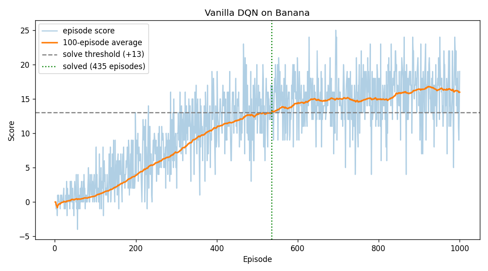
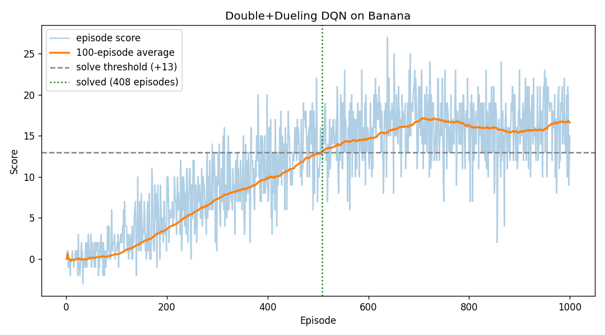
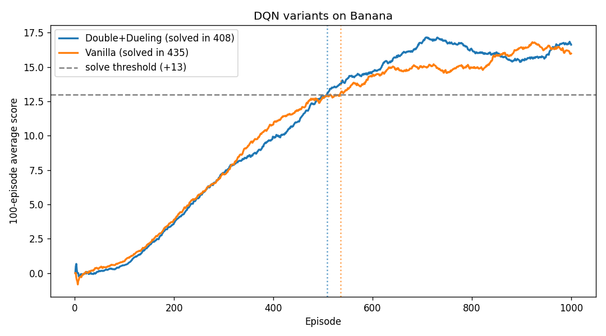

# Report: Banana Navigation with Deep Q-Networks

## Summary

| Variant | Solved in | Best 100-ep avg | Final 100-ep avg | Training time |
|---|---|---|---|---|
| Vanilla DQN | **435 episodes** | 16.81 | 15.98 | 35 min (CPU) |
| Double + Dueling DQN | **408 episodes** | 17.15 | 16.62 | 35 min (CPU) |

Both variants solved the environment, reaching an average of +13 or more over 100 consecutive episodes, well within the 1,800-episode benchmark. The submitted model (`checkpoint.pth`, Double + Dueling) averages **16.23 over 100 episodes** when evaluated greedily (ε = 0) after training.

"Solved in N episodes" follows the course convention: N is the episode just before the first 100-episode window whose average reaches +13. For example, Double + Dueling averaged 13.01 over episodes 409–508, so it solved in 408 episodes.

## Learning algorithm

### Deep Q-Network (DQN)

The agent learns an action-value function Q(s, a; θ) with a neural network and acts ε-greedily with respect to it. Two standard techniques from Mnih et al. (2015) stabilize learning:

1. **Experience replay.** Transitions (s, a, r, s′, done) are stored in a 100,000-entry buffer, and the network trains on uniformly sampled minibatches of 64. This breaks the correlation between consecutive steps and reuses each experience many times.
2. **Fixed Q-targets.** A separate target network θ⁻ computes the learning targets. Rather than copying weights periodically, it tracks the local network with a soft update after every learning step: θ⁻ ← τ·θ + (1 − τ)·θ⁻, with τ = 0.001.

The local network minimizes the mean squared error between Q(s, a; θ) and the TD target:

    y = r + γ · max_a′ Q(s′, a′; θ⁻) · (1 − done)

Learning happens every 4 environment steps, once the buffer holds at least one minibatch.

**Exploration.** ε starts at 1.0 (fully random) and decays multiplicatively by 0.995 per episode to a floor of 0.01. It reaches about 0.08 by episode 500.

### Double DQN (van Hasselt et al., 2016)

Standard DQN uses the same max operator to both select and evaluate the next action, which systematically overestimates Q-values. Double DQN decouples the two steps. The local network picks the action, and the target network scores it:

    y = r + γ · Q(s′, argmax_a′ Q(s′, a′; θ); θ⁻) · (1 − done)

This is a one-line change in `dqn_agent.py` (`learn()`), enabled with `--double`.

### Dueling DQN (Wang et al., 2016)

The network's head is split into two streams: a scalar state value V(s), and an advantage A(s, a) for each action. They are recombined as:

    Q(s, a) = V(s) + (A(s, a) − mean_a′ A(s, a′))

Subtracting the mean advantage makes V and A identifiable. The benefit is that V(s) is learned from every update, whichever action was taken. That helps in states where the choice of action barely matters, such as when no bananas are nearby. It is enabled with `--dueling`.

## Model architecture

Both variants share a 2-layer MLP body. All layers are fully connected, with ReLU activations on the hidden layers.

**Vanilla:**

    state (37) → Linear(37, 64) → ReLU → Linear(64, 64) → ReLU → Linear(64, 4) → Q-values (4)

**Dueling:**

    state (37) → Linear(37, 64) → ReLU → Linear(64, 64) → ReLU ─┬→ Linear(64, 1) → V(s)
                                                                └→ Linear(64, 4) → A(s, a)
                                           Q(s, a) = V(s) + A(s, a) − mean(A)

The input is the raw 37-dimensional state with no normalization. The ray values are already in [0, 1], and the velocity components are small.

## Hyperparameters

| Hyperparameter | Value | Where |
|---|---|---|
| Replay buffer size | 100,000 | `dqn_agent.py` |
| Minibatch size | 64 | `dqn_agent.py` |
| Discount factor γ | 0.99 | `dqn_agent.py` |
| Soft update rate τ | 0.001 | `dqn_agent.py` |
| Learning rate (Adam) | 0.0005 | `dqn_agent.py` |
| Learn every | 4 steps | `dqn_agent.py` |
| Hidden layers | 64, 64 | `model.py` |
| ε start / end / decay | 1.0 / 0.01 / 0.995 per episode | `train.py` |
| Max steps per episode | 1000 (episodes end at 300) | `train.py` |
| Episodes trained | 1000 | `train.py` |
| Random seed | 0 | `train.py` |

All hyperparameters were kept identical across both variants, so the comparison isolates the effect of the Double and Dueling changes.

## Results

### Plot of rewards

**Vanilla DQN** solved in 435 episodes:

**Double + Dueling DQN** solved in 408 episodes:

Each plot shows the score for every episode (light) and the 100-episode rolling average (bold). The dashed line is the +13 threshold, and the dotted line marks the episode where the solve criterion was met.

**Comparison of 100-episode averages:**

| Episode | Vanilla avg | Double + Dueling avg |
|---|---|---|
| 100 | 0.86 | 0.57 |
| 200 | 3.90 | 3.64 |
| 400 | 10.81 | 9.92 |
| 500 | 12.81 | 12.82 |
| 1000 | 15.98 | 16.62 |

### Discussion

- **The learning curves are nearly identical until about episode 500.** In this phase, learning is mostly limited by exploration: ε stays above 0.1 until about episode 460, so a large share of actions are still random.
- **Double + Dueling solves slightly sooner (408 against 435) and plateaus slightly higher (best 17.15 against 16.81).** That fits the theory. Once exploration drops off, the more accurate value estimates should help the agent choose between nearby bananas.
- **The difference is small, and each variant was trained with a single seed.** A 27-episode gap is within the run-to-run variance typical of DQN, so it shouldn't be read as a decisive win. The environment is simple: a 37-dimensional state, 4 actions, and a dense reward. That leaves little overestimation for Double DQN to correct.
- **Greedy performance holds up.** With exploration switched off, the submitted model averages 16.23 over 100 episodes, which confirms the saved weights solve the environment on their own.

## Ideas for future work

1. **Multiple seeds with confidence intervals.** Training each variant on 5 or more seeds and reporting the mean and standard deviation of the solve episode would show whether the Double + Dueling gain is real. This matters most because the current comparison rests on one run each.
2. **Prioritized experience replay (Schaul et al., 2016).** Sampling transitions in proportion to their TD error would replay rare, informative events more often, such as actually reaching a banana. This should speed up the early learning phase, which is the bottleneck here.
3. **Tuning the exploration schedule.** The flat early curves suggest ε decays more slowly than needed. Trying faster decays (0.98–0.99) or a linear schedule could cut the solve time noticeably, at some risk of converging prematurely.
4. **Other Rainbow components (Hessel et al., 2018).** Candidates include multi-step returns (n-step targets propagate the banana reward faster), noisy networks (learned exploration in place of ε-greedy), and distributional RL (C51). Adding them one at a time would show which contributes most here.
5. **Learning from pixels.** The optional VisualBanana environment provides raw 84×84 RGB frames instead of ray-casts. A convolutional Q-network with frame stacking would test whether the agent can learn its own perception rather than relying on hand-built features.
6. **Hyperparameter search.** A small sweep over learning rate, τ, network width and batch size, using a tool such as Optuna, would likely find settings that solve in fewer episodes than the course defaults used here.

## References

- Mnih et al. (2015). *Human-level control through deep reinforcement learning.* Nature.
- van Hasselt, Guez & Silver (2016). *Deep Reinforcement Learning with Double Q-learning.* AAAI.
- Wang et al. (2016). *Dueling Network Architectures for Deep Reinforcement Learning.* ICML.
- Schaul et al. (2016). *Prioritized Experience Replay.* ICLR.
- Hessel et al. (2018). *Rainbow: Combining Improvements in Deep Reinforcement Learning.* AAAI.
